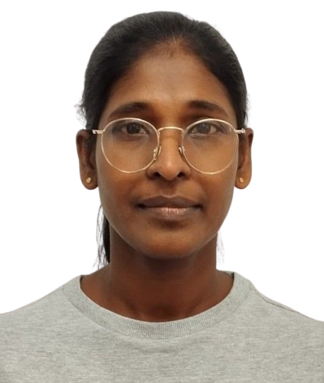

## About Me

  

I am an environmental scientist with more than fifteen years of combined experience in marine and coastal pollution prevention and science education. My academic path and professional practice are closely connected by a strong interest in how water, coasts, and human activities interact, and how spatial data can support better decisions in these systems. I particularly enjoy bridging technical analysis with clear communication for students, communities, and decision‑makers.

## Education

- Honour Bachelor’s in Forestry and Environmental Science – University of Sri Jayewardenepura, Sri Lanka  
- Master of Philosophy in Integrated Water Resources Management – University of Peradeniya, Sri Lanka  
- Postgraduate Diploma in Education – University of Colombo, Sri Lanka  
- Certificate Course in Coastal Zone Management – Asian Institute of Technology, Thailand  
- Master’s in Applied Geoinformatics (ongoing) – Paris Lodron University of Salzburg, Austria  

## Professional Experience

- More than 8 years in the marine pollution prevention sector, working on the protection and management of coastal and marine environments.  
- More than 7.5 years as a secondary school science teacher, developing strong skills in teaching, mentoring, and explaining complex scientific concepts in an accessible way.

## Research and Interests

My research experience includes coastal water quality monitoring and environmental economics, with a focus on understanding how environment pollution and management choices affect ecosystems and communities. Currently, I am expanding this work through applied geoinformatics, using satellite image analysis, geovisualization, and remote sensing to support environmental management. I am particularly interested in applications that combine water resources, coastal systems, and spatial technologies to enhance currently available practical tools for improved policy and local action.
